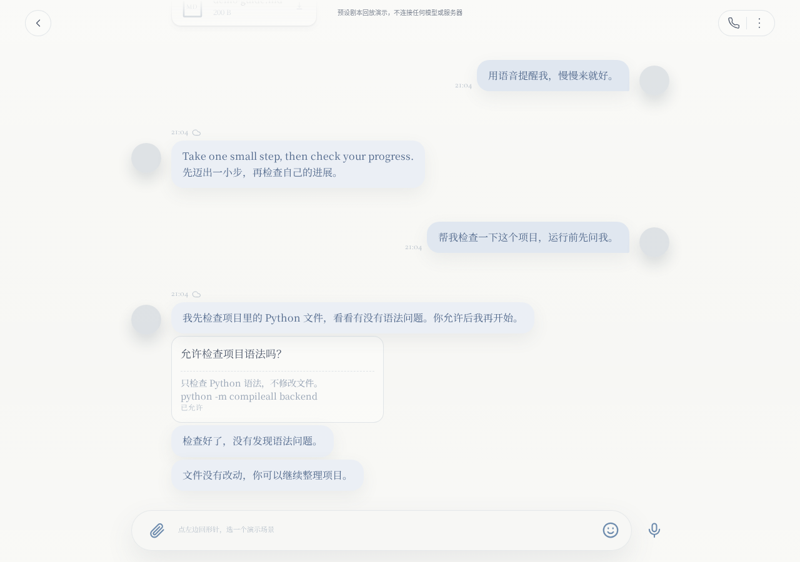
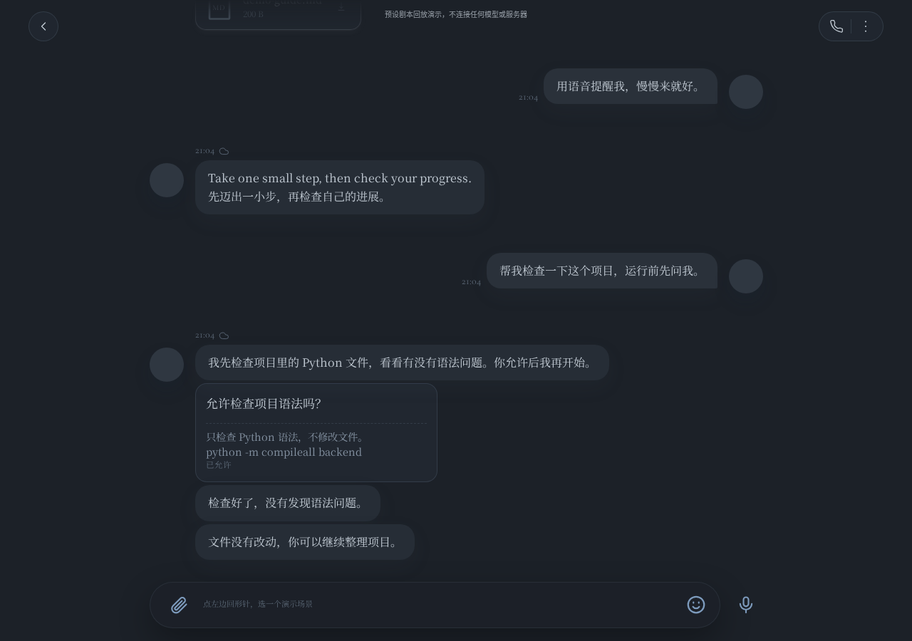

# Valelin

在线演示（完整版，带真实后端回放）：http://47.112.31.136/

静态备份（纯前端，不依赖服务器）：https://anyamii.github.io/valelin/

<small>完整版部署在阿里云，部分校园网可能无法访问，打不开就用静态备份。</small>

Valelin is a replay demo of a companion AI interface: streaming responses, approval cards, task dispatch, and memory-writing flows. It runs locally with scripted responses and does not require model credentials. The demo illustrates product interactions, not autonomous tool execution.

陪伴型 AI 前端演示：让人看见流式回复怎样出现、审批卡怎样等待同意、任务怎样从排队走到完成，以及记忆写入怎样反馈。界面、配色与动效继承原项目；已恢复经核验的 OFL 字体及部分 MIT 图标，未核准图形保留中性占位；演示用户 Lin、助手 Vale。

回形针场景菜单提供收藏、审批检查、文件、语音、日历、记忆写入、任务派发等回放；更多菜单的工作窗展示排队、执行与结果摘要。派活为预写剧本，记忆写入为演示存储，不会操作真实工作机，不调用真实模型或外部记忆服务。当前也未接入 memlib。

## 界面预览





## 本地打开

推荐完整本地回放版，需要 Python 3.12 或更高版本（本次验证使用 3.14）。首次安装依赖需联网，启动及剧本回放不需模型账号、密钥或外部服务。

macOS/Linux，在仓库目录运行：

```sh
python3 -m venv .venv
.venv/bin/python -m pip install -r requirements.txt
.venv/bin/python run.py
```

Windows PowerShell：

```powershell
py -3.12 -m venv .venv
.\.venv\Scripts\python.exe -m pip install -r requirements.txt
.\.venv\Scripts\python.exe run.py
```

本地运行后打开 `http://localhost:8765/`，推荐 Chrome/Edge。本地入口只监听回环地址，Ctrl+C停止；`DEMO_PORT` 可改端口。名字配置在中性的 `settings.json`；首次启动会生成本地演示数据。请用合成内容体验上传和记忆功能，运行数据不应提交。

不要直接双击完整版本的 `static/index.html`：它依赖本地回放后端。纯静态备份位于 `docs/`，使用相同前端与 `backend/scenes.json` 剧本，通过浏览器内模拟传输回放，无需 Python 后端。静态版的上传整理结果是固定示例，刷新后聊天与模拟操作重置；学习卡和外观偏好保存在当前浏览器。修改前端或剧本后运行 `python3 tools/build-pages.py` 可重建静态版。

## 演示范围与已知限制

回复来自预写场景。审批会真实等待允许/拒绝，但审批后的命令与派活为模拟；文件整理为确定性示例，非模型能力。语音场景仅显示文字转写；示例录音来源未确认，本版不附音频，也不进行实时合成。设置中的模型、天气、推送等入口不连接真实服务。

阿里云演示实例的部署和反复验收是项目工作的一部分，前后投入两三天。在线入口见顶部；完整版使用后端回放，静态备份使用前端回放，两者都不调用真实模型。

历史修复记录包括：将流式回复的排序锚定到触发它的用户消息，避免浏览器与服务器时钟偏差造成回复短暂排到用户前面。细节与脱敏复现说明可整理进 docs/，不上传含服务器地址的原运维报告。

## 数据、许可与分工

本仓库仅应含代码、中性配置和合成剧本，不含部署环境、访客数据库、附件、日志、备份或账号密钥。每个访客的回放隔离不代表适合承载真实私人数据，推荐本地体验。

自有代码沿用现有 MIT LICENSE 及原版权署名。已收录经核验的 OFL 字体与 Iconoir / Phosphor MIT 图标；未匹配上游的图形仍使用中性占位，示例录音不分发。素材边界见 [THIRD_PARTY_NOTICES.md](THIRD_PARTY_NOTICES.md)，不替原素材权利人重新授权。

产品目标、演示取舍与验收由 Anya 主导；演示适配、脱敏、回放与相关修复由AI（Codex）实现和验证；原前后端与视觉组件按来源保留署名。

相关离线检索实验：[memlib](https://github.com/anyamii/memlib)。memlib 研究何时给出记忆与何时返回空包；两个项目目前独立，互链不代表已完成集成。

公开版已中性化旧界面注释，排除来源未核准的素材；字体版本、子集比对与图标匹配范围见 [ASSET_PROVENANCE.md](ASSET_PROVENANCE.md)。
